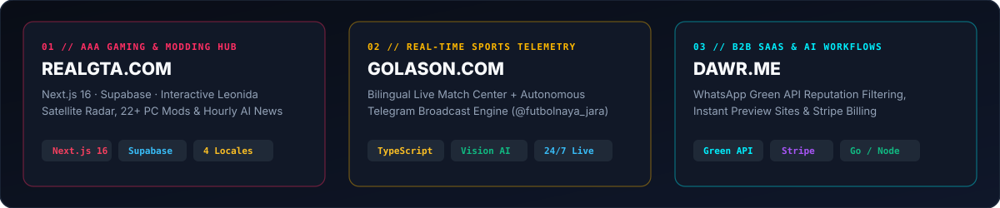

  

 

  &nbsp;
  &nbsp;
  &nbsp;
  

---

### ⚡ Flagship Production Systems

  

| Platform | Architecture & Capabilities | Stack | Status |
| :--- | :--- | :--- | :---: |
| **[REALGTA.COM](https://realgta.com)** | **Vice Nights // AAA Editorial & Mod Hub:** Interactive Leonida satellite coordinate map, 22+ verified PC mod mirrors, community forums, and autonomous hourly AI news syndication across 4 languages (`EN` · `RU` · `ES` · `HY`). | `Next.js 16` · `TypeScript` · `Supabase` · `Gemini 2.5` · `Tailwind` | 🟢 **LIVE** |
| **[GOLASON.COM](https://golason.com)** | **Bilingual Football Match Center & [@futbolnaya_jara](https://t.me/futbolnaya_jara):** Real-time European football telemetry, automated broadcast frame vision verification, FotMob studio overlays, and 24/7 live match coverage. | `Next.js` · `TypeScript` · `Python` · `Pillow` · `Vision AI` | 🟢 **LIVE** |
| **[DAWR.ME](https://dawr.me)** | **B2B Reputation & Conversion SaaS:** Automated Google Maps review filtering via WhatsApp Green API, instant white-label business preview sites, and Stripe recurring billing. | `TypeScript` · `Go` · `Node.js` · `Green API` · `Stripe` | 🟢 **LIVE** |

---

### 🛠️ Core Engineering Stack

  
  
  
  
  
  
  
  
  
  
  
  

---

### 📐 Engineering Focus

- **Autonomous Multi-Agent Pipelines:** Designing 24/7 background daemons that ingest live telemetry, verify visual media with multimodal LLMs, and publish across web, Telegram, Telegra.ph, and Reddit with zero manual intervention.
- **High-Performance Web Architecture:** Shipping multi-locale Next.js App Router platforms with instant theme switching, SEO structured data (`JSON-LD` + dynamic `sitemap.xml`), and sub-50ms Nginx reverse-proxy delivery.
- **Full-Cycle Product Engineering:** From database schema design (PostgreSQL / Supabase RLS) and OAuth 2.0 PKCE flows to bespoke SVG/Canvas data visualization.
